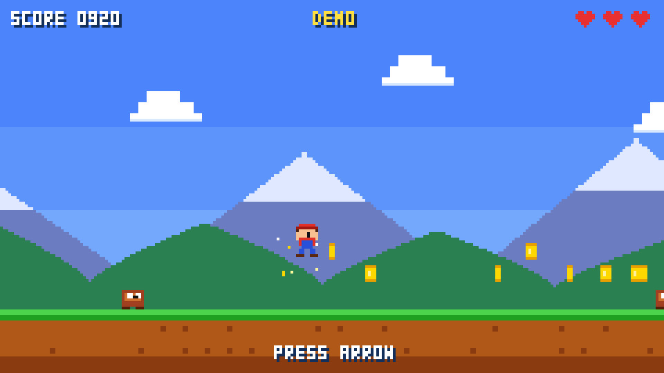
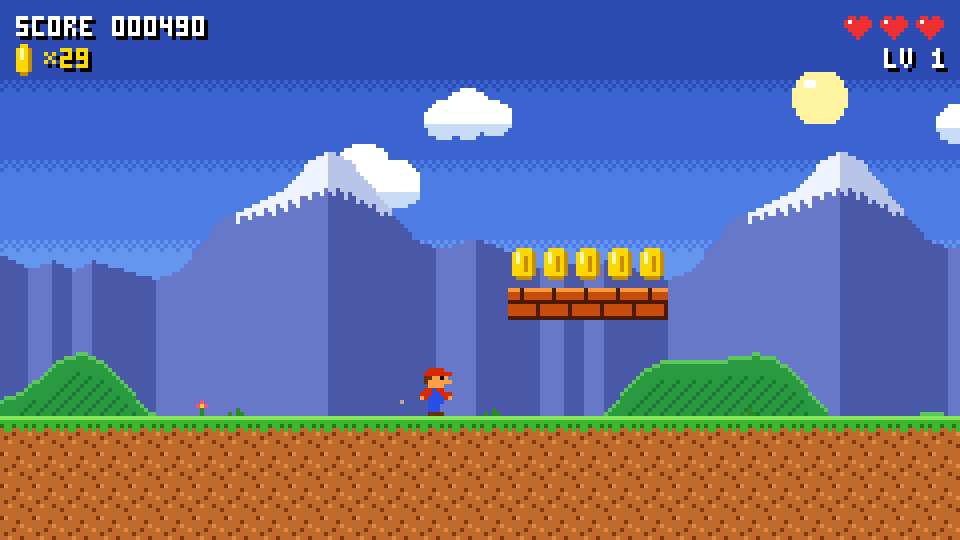
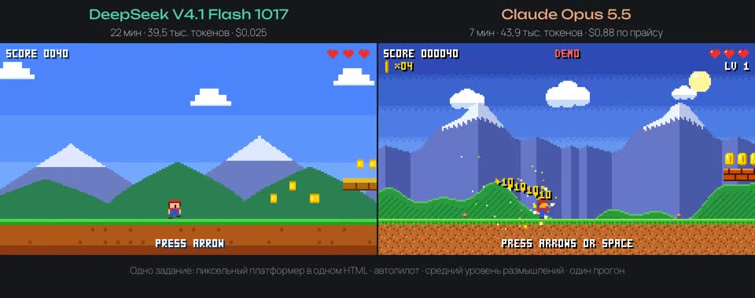

# llm-pixel-duel

Одно задание для двух моделей: сделать 8-битный платформер в одном HTML-файле, с автопилотом. Соревновались **DeepSeek V4.1 Flash 1017** и **Claude Opus 5.5**, обе с уровнем размышлений medium. Обе игры работают, в них можно поиграть в браузере.

**Играть:** https://neurostack-lab.github.io/llm-pixel-duel/

| DeepSeek V4.1 Flash 1017 | Claude Opus 5.5 |
|---|---|
|  |  |

[](media/duel.mp4)

Ролик на 25 секунд: обе игры в режиме демо рядом, со звуком. Файл: [media/duel.mp4](media/duel.mp4).

## Итоги

| | DeepSeek V4.1 Flash 1017 | Claude Opus 5.5 |
|---|---|---|
| Где запускали | OpenRouter | Anthropic API, через подписку Claude |
| Время ответа | 22 мин 10 с | 7 мин 8 с |
| Скорость вывода | ≈30 ток/с | ≈103 ток/с |
| Токены на выходе | 39 474 | 43 922 |
| Из них размышления | 32 583 | 31 190 |
| Цена | $0,025 (списание OpenRouter) | ≈$0,88 (по прайсу OpenRouter: $4 / $20 за 1M) |
| Размер игры | 17 КБ, 607 строк | 21 КБ, 473 строки |
| Ошибки JS | 0 | 0 |
| Автопилот, проверка 40 с | играет, game over нет, 1 раз получил урон | играет, game over нет, прошёл уровень |

Opus ответил втрое быстрее. DeepSeek обошёлся примерно в 35 раз дешевле. Токенов обе модели потратили почти поровну, и большая часть ушла на размышления: 83 % у DeepSeek и 71 % у Opus.

Сырые замеры по каждому запросу лежат в [results.json](results.json).

## Как сравнивали

- Одно сообщение с заданием, без системного промпта. Текст дословно и параметры запуска — в [prompt.md](prompt.md).
- `max_tokens` 64 000, уровень размышлений medium, остальные настройки по умолчанию.
- Из ответа взяли блок `html` и ничего в нём не меняли.
- Каждую игру открыли в headless Chromium и проверили: загружается без ошибок, автопилот играет сам.

## Оговорки

- **Один прогон.** Это замер, а не бенчмарк. Повторный запуск может дать другую игру, другое время и другое число токенов.
- **Цена Opus посчитана, а не списана.** Модель вызывали через подписку Claude, поэтому цену мы пересчитали по прайсу OpenRouter: 510 × $4/1M + 43 922 × $20/1M ≈ $0,88.
- **Время зависит от провайдера и нагрузки.** Скорость DeepSeek на OpenRouter зависит от того, к какому провайдеру попал запрос.

## Звук добавили мы

В задании было сказано «звук не нужен», и модели его не делали. Видео без звука смотрится скучно, поэтому мы добавили звук сами:

- [sound/sfx.js](sound/sfx.js) — 8-битный синтезатор на WebAudio, без файлов и сети. Он даёт звуки прыжка, монеты, прыжка на врага, приземления, урона и смерти, а также фоновую чиптюн-мелодию. В игре Opus есть ещё удар по кирпичу, 1UP и конец уровня.
- [sound/build.py](sound/build.py) собирает `deepseek/index.html` и `opus/index.html` из оригиналов. Он встраивает модуль и добавляет вызовы `__SFX.play('…')` в момент событий. Геймплей, графика и автопилот не меняются. Каждая правка — строгая замена, которая встречается в оригинале ровно один раз, так что дифф с оригиналом легко прочитать.
- **Оригиналы без изменений:** [raw/deepseek.html](raw/deepseek.html) и [raw/opus.html](raw/opus.html).

Звук включается первой клавишей или касанием (так требуют браузеры). Клавиша <kbd>M</kbd> выключает и включает звук.

## Как запустить локально

Нужен только браузер. Скачайте репозиторий и откройте `index.html` или любую игру напрямую:

```bash
git clone https://github.com/neurostack-lab/llm-pixel-duel && cd llm-pixel-duel
xdg-open index.html          # macOS: open index.html
```

Если браузер не открывает локальные файлы, поднимите простой сервер:

```bash
python3 -m http.server 8000  # затем http://localhost:8000
```

Пересобрать игры со звуком из оригиналов:

```bash
python3 sound/build.py
```

## Структура

```
index.html            страница выбора игры
deepseek/index.html   игра DeepSeek со звуком
opus/index.html       игра Opus со звуком
raw/                  оригинальные ответы моделей, без изменений
sound/                звуковой модуль и сборка
prompt.md             задание и параметры запуска
results.json          замеры: время, токены, цена
media/                скриншоты и ролик со звуком
```

## Авторы

[НейроСтек](https://t.me/neurostack_news): локальные модели, open-source и инструменты. Ещё наши каналы: [НейроСигнал](https://t.me/neurosignal_news) и [НейроДеньги](https://t.me/neurodengi_news). Другие проекты: [github.com/neurostack-lab](https://github.com/neurostack-lab).

Лицензия MIT распространяется на наш код: звуковой модуль, сборку и страницу. Игры сгенерированы моделями, подробности в [LICENSE](LICENSE).
